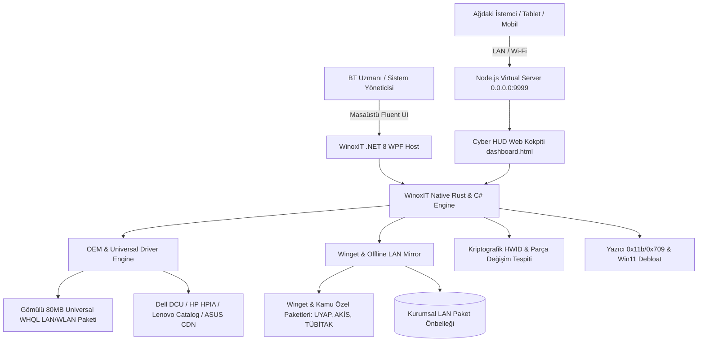

# ⚡ WinoxIT — Enterprise Windows IT, Hardware & Deployment Suite

<p align="center">
  
  
  
  
  
  
</p>

---

## 📌 Genel Bakış (Executive Overview)

**WinoxIT**, kurumsal BT departmanları, sistem yöneticileri, kamu kurumları (BTK, Bakanlıklar) ve profesyonel teknik servisler için sıfırdan tasarlanmış **yeni nesil hibrit Windows bakım, donanım kimlik doğrulama, OEM sürücü orkestrasyonu ve uzaktan yönetim platformudur.**

Geleneksel hantal RMM yazılımlarının ve karmaşık domain altyapılarının aksine WinoxIT; hem **USB bellekten bağımsız (portable)** çalışabilen ultra hızlı bir mühendislik konsolu, hem de yerel ağda **`0.0.0.0:9999`** üzerinden tüm mobil cihazlardan ve bilgisayarlardan yönetilebilen asenkron bir sanal sunucu ve dağıtım istasyonudur.

---

## 🏗️ 4 Katmanlı Hibrit Mimari (Architecture)



---

## 📊 Sektörel Kıyaslama & Rekabet Üstünlüğü (Competitive Matrix)

| Yetenek & Modül | **WinoxIT Suite** | Chris Titus WinUtil | Optimizer (Hellzerg) | BloatyNosy | Tactical RMM / PDQ Deploy |
| :--- | :---: | :---: | :---: | :---: | :---: |
| **Ağ / Web Kokpiti (LAN & Mobil)** | 🌟 **Var (Node.js 0.0.0.0:9999)** | ❌ Sadece Yerel GUI | ❌ Sadece Yerel GUI | ❌ Sadece Yerel GUI | ⚠️ Ağır Sunucu İster |
| **Gömülü Evrensel Ağ Kartı Paketi** | 🌟 **Var (WHQL Offline NIC)** | ❌ Yok | ❌ Yok | ❌ Yok | ❌ Yok |
| **Anakart Tespiti & Orijinal OEM Driver**| 🌟 **Var (Dell/HP/Lenovo/ASUS)** | ❌ Yok | ❌ Yok | ❌ Yok | ⚠️ Kısmi / Manuel |
| **Ninite Benzeri Silent App Dağıtımı** | 🌟 **Var (LAN Cache Mirror)** | ⚠️ Sadece Winget | ❌ Yok | ❌ Yok | ⚠️ Karmaşık Paketleme |
| **Kriptografik HWID Parça Drift Alarmı**| 🌟 **Var (SHA-256 Ekspertiz)** | ❌ Yok | ❌ Yok | ❌ Yok | ❌ Yok |
| **Kurumsal Yazıcı 0x11b / 0x709 Onarımı**| 🌟 **Var (Özel Spooler Motoru)** | ❌ Yok | ❌ Yok | ❌ Yok | ❌ Yok |
| **Win 11 Copilot / Recall / Telemetri** | 🌟 **Var (BİGR Kamu Sıkılaştırma)**| ✅ Var | ✅ Var | ✅ Var | ❌ Yok |
| **Kapalı Ağ (Air-Gapped) Desteği** | 🌟 **Tam Uyumlu (Offline Repo)** | ❌ İnternet Şart | ⚠️ Kısmi | ❌ İnternet Şart | ⚠️ Ek Lisans |
| **Kamu Özel Paketleri (UYAP / AKİS)** | 🌟 **Entegre** | ❌ Yok | ❌ Yok | ❌ Yok | ❌ Yok |

---

## 🎯 Katil Ticari Özellikler (Killer Features)

### 1. 🚀 Gömülü Evrensel Çevrimdışı Ağ Kartı Sürücü Paketi (Universal Offline NIC Engine)
* **Problem:** Format sonrası bilgisayarların büyük bölümünde ağ kartı sürücüsü otomatik yüklenmez; internet olmadığı için hiçbir sürücü indirilemez (teknisyenin en büyük zaman kaybı).
* **WinoxIT Çözümü:** 
  * En sık kullanılan Ethernet ve Wi-Fi üreticilerinin (Intel I219/I225/AX200/AX210, Realtek RTL8111/8125/8821/8822, Broadcom, MediaTek, Atheros) WHQL onaylı sürücülerini ZSTD/LZMA ile sıkıştırılmış **~80-120 MB** ultra hafif bir arşivde barındırır.
  * Windows PnP Device ID'yi anında tarar; eksik ağ kartını tespit edip `pnputil.exe` ile **5 saniye içinde internetsiz devreye alır.**

### 2. 🔍 Ağ Üzerinden Anakart Tespiti ve Orijinal OEM Sürücü İndirici
* **Otomatik SMBIOS/DMI Analizi:** Anakart üreticisi, model adı, BIOS sürümü, sistem SKU ve PCI donanım kimliklerini çıkarır.
* **Resmi Kurumsal Katalog API Entegrasyonu:**
  * **Dell:** Dell Business Client Catalog (`dcu-cli.exe` & Dell Service Tag API).
  * **HP:** HP Image Assistant (HPIA) & HP CMSL Softpaq katalogları.
  * **Lenovo:** Lenovo System Update / ThinInstaller XML API.
  * **Tüketici Anakartları (ASUS, MSI, Gigabyte, ASRock):** Model bazlı resmi destek CDN ve Intel/Realtek chipset havuzu.
* **Ağ Üzerinden Dağıtım:** Hedef bilgisayarın donanım kimliğini uzaktan okuyup sürücü paketini ana istasyona indirme, yerel ağdan hedef makineye aktarıp sessizce kurma.

### 3. 📦 Kurumsal AppDeploy: Ninite / Winget Sessiz Kurulum & LAN Önbelleği
* **Görsel Yazılım Marketi:** Tek ekrandan kategorize edilmiş yazılımları seçme (Tarayıcılar, Ofis, Geliştirici Araçları, Medya, Sistem Araçları).
* **Tek Tıkla Sessiz (Silent / Unattended) Kurulum:** Reklam, toolbar veya "İleri" butonları olmadan arka planda otomatik kurulum.
* **Kamu & Kurum Özel Paketleri:** UYAP Editör, Kamu e-İmza sürücüleri (AKİS / TÜBİTAK UEKAE), E-Fatura araçları, DYS hazır konfigürasyonları.
* **Yerel LAN Önbellekleme (Offline Mirror):** Bir program bir kez indirildiğinde `C:\WinoxIT\Cache` klasörüne depolanır. Ağdaki diğer bilgisayarlar internet kotası harcamadan yerel ağdan saniyeler içinde kurulur.

### 4. 🛡️ Kriptografik Donanım Ekspertizi & Parça Değişim Tespiti (HWID Drift)
* **Zimmet ve Parça Güvenliği:** Cihaz teslim alındığında anakart, CPU, RAM slotları ve SSD/NVMe seri numaralarının deterministik SHA-256 parmak izini alır.
* **Drift / Sapma Alarmı:** Servis sonrası veya periyodik denetimlerde RAM sökülmesi, SSD değiştirilmesi durumunda kırmızı alarm verir ve resmi mühürlü PDF/HTML raporu üretir.

### 5. 🖨️ Kurumsal Yazıcı & Spooler Onarım Paketi
* **0x0000011b RPC Yetkilendirme Onarımı:** Windows Update sonrası ağ yazıcılarında yaşanan RPC hatasını tek tıkla onarır.
* **0x00000709 Point & Print Politika Onarımı:** Sürücü kısıtlamalarını sıfırlar.
* **Akıllı Spooler Karantinası:** Kilitlenen yazdırma işlerini arka planda temizler.

### 6. ⚡ Windows 11 Next-Gen Debloat & BİGR Kamu Güvenlik Kalkanı
* **AI Telemetrisi Engelleme:** Windows 11 Copilot ve Windows Recall veri toplamayı GPO/Registry üzerinden engeller.
* **BİGR Kamu Sıkılaştırması:** SMBv1, LLMNR, NBT-NS broadcast protokollerini kapatarak ağ içi sızmaları engeller.
* **USB DLP Denetimi:** USB depolama birimlerini tek tıkla salt-okunur yapar veya engeller.
* **Klasik Sağ Tık:** Windows 10 klasik bağlam menüsünü tek tıkla geri getirir.

---

## 🚀 Hızlı Başlangıç (Quick Start)

### Gereksinimler:
* **İşletim Sistemi:** Windows 10 / Windows 11 / Windows Server 2016+ (x64)
* **Yönetici Yetkisi:** Komut satırının veya uygulamanın *Yönetici Olarak* çalıştırılması gerekir.
* **Opsiyonel (LAN Sunucusu İçin):** Node.js v18+ (Dahili `server.js` çalıştırmak için).

### 1. Masaüstü WPF Arayüzünü Başlatma
```powershell
cd gui
dotnet run
```

### 2. Node.js Virtual Server & Web Kokpitini Başlatma
Tek tıkla başlatmak için kök dizindeki `Launch-NodeServer.cmd` dosyasını çalıştırın veya:
```powershell
node server.js
```
Tarayıcınızdan açın:
* **Yerel Erişim:** `http://localhost:9999/dashboard.html`
* **LAN / Wi-Fi Erişimi:** `http://[BILGISAYAR-IP-ADRESI]:9999/dashboard.html`

---

## 📂 Proje Dizin Yapısı

```text
WinoxIT/
├── .github/                         <-- CI/CD Workflows & Issue Templates
│   └── workflows/build.yml
├── drivers/                         <-- Evrensel Çevrimdışı Sürücü Deposu
│   ├── universal_nic/               <-- Intel, Realtek, Broadcom sıkıştırılmış INF arşivi
│   └── oem_scripts/                 <-- Dell, HP, Lenovo katalog orkestrasyon araçları
├── packages/                        <-- Yerel LAN Yazılım Önbelleği (Offline Mirror)
│   ├── kamu/                        <-- UYAP, AKİS, TÜBİTAK e-İmza paketleri
│   └── common/                      <-- Chrome, 7-Zip, AnyDesk vb. MSI/EXE paketleri
├── gui/                             <-- .NET 8 WPF Fluent UI masaüstü uygulaması
│   ├── WinoxIT.csproj
│   ├── MainWindow.xaml / cs         <-- Ana kontrol ve vitrin arayüzü
│   ├── Styles/FluentStyles.xaml     <-- Kurumsal Fluent Koyu Tema
│   └── Services/NativeSystemEngine.cs
├── core/                            <-- Native Rust çekirdek motoru ve CLI
│   ├── Cargo.toml
│   └── src/modules/
│       ├── hardware.rs              <-- SMBIOS & Kriptografik HWID
│       ├── printer.rs               <-- 0x11b / 0x709 Onarım motoru
│       └── debloat.rs               <-- Copilot / Recall kalkanı
├── web/                             <-- Mobil & Uzak Cihazlar için Cyber HUD Kokpiti
│   └── dashboard.html               <-- Bağımsız 10 modüllü siber web kokpiti
├── server.js                        <-- 0.0.0.0:9999 Yüksek eşzamanlı sanal sunucu
├── Launch-NodeServer.cmd            <-- Güvenlik duvarı ve sunucu tek tık başlatıcı
├── README.md                        <-- Proje ana dokümantasyonu
├── ROADMAP.md                       <-- Ayrıntılı stratejik yol haritası
├── CHANGELOG.md                     <-- Sürüm geçmişi
└── LICENSE                          <-- Kurumsal ticari lisans sözleşmesi
```

---

## 📄 Lisans & Telif Hakkı

Copyright © 2026 **M. Tahir Yılmaz / WinoxIT Systems**. Tüm Hakları Saklıdır.  
Bu yazılım kurumsal kullanım ve ticari lisanslama standartlarına uygun olarak geliştirilmiştir.
