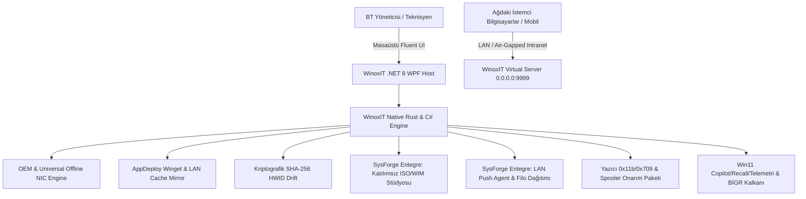

# ⚡ WinoxIT — Enterprise Windows IT, Hardware & Deployment Suite
## Kurumsal, Ticari ve Entegre Sistem Geliştirme Yol Haritası (Master Strategic Roadmap)

> **Proje:** WinoxIT (Flagship / Ana Platform)  
> **Mimari:** .NET 8 WPF Fluent UI + Native Rust Çekirdek Motoru + Node.js 0.0.0.0:9999 Sanal Sunucu & LAN Kokpiti  
> **Hedef Kitle:** Kamu Kurumları, Bilgi İşlem Daireleri, Kurumsal Şirketler, Sahada Çalışan Ağ/Sistem Mühendisleri ve Profesyonel Teknik Servisler.  
> **Uyumluluk Standardı:** Cumhurbaşkanlığı Dijital Dönüşüm Ofisi *Bilgi ve İletişim Güvenliği Rehberi (BİGR)*, KVKK ve Tamamen Çevrimdışı (Air-Gapped) Ağ Desteği.

---

## 1. 🌐 Piyasa Analizi ve Ticari Konumlandırma

Piyasadaki mevcut çözümler ya tekil teknisyen scriptleridir (kurumsal güvenlik ve merkezi yönetimden yoksundur) ya da ağır, aşırı pahalı ve kapalı ağlarda çalışamayan RMM yazılımlarıdır:

| Kategori | Mevcut Pazar Çözümleri | Sektörel Açık & Zayıflık | **WinoxIT Kurumsal Avantajı** |
| :--- | :--- | :--- | :--- |
| **Toplu Program Kurulumu** | Ninite, Patch My PC | Ninite kapalı ağlarda (air-gap) çalışmaz; proxy desteği zayıftır; cihaz başı lisansı pahalıdır. | **WinoxIT AppDeploy:** Winget sessiz motoru + **Yerel LAN Önbellekleme (Offline Mirror)** ile internet kotasını tüketmeden 1 Gbps LAN hızında sessiz kurulum. Kamu e-İmza / UYAP hazır paketleri. |
| **Sürücü & Donanım Tespiti** | Snappy Driver (SDI), 3DP Net | SDI 50 GB güvensiz torrent sürücüleri çeker; 3DP Net eski ve reklamlıdır. Kurumlara sokulamaz. | **WinoxIT DriverEngine:** Yalnızca **resmi üretici (Dell, HP, Lenovo, Asus vb.) WHQL imzalı kataloglardan** çeker. Dahili **Evrensel Çevrimdışı LAN/WLAN Paketi** ile format sonrası anında internetsiz sürücü enjeksiyonu. |
| **Donanım Ekspertizi** | AIDA64, HWiNFO | Değişen parçaları geçmişe dönük kriptografik olarak denetleyemez (Anti-tamper / zimmet takibi yoktur). | **Kriptografik HWID Drift:** SHA-256 ile RAM, SSD, CPU parça değişimini kırmızı alarmla tespit eden kurum onaylı zimmet/ekspertiz raporlama. |
| **Katılımsız Kurulum & İmaj** | NTLite, Rufus | Ağ üzerinden dağıtım yapamaz; ISO içerisine tek tıkla kurumsal profil/ajan enjekte edemez. | **SysForge Entegre ISO/WIM Stüdyosu:** Win11 TPM/SecureBoot bypass autounattend.xml ve DISM sürücü/yazılım enjeksiyonu. |
| **Ağ İçi Filo Yönetimi** | Tactical RMM, ManageEngine | Ağır sunucu ve veritabanı altyapısı ister; sahada USB'den anında çalışamaz. | **Hibrit Taşınabilir İstasyon:** Sıfır kurulumla USB'den çalışan bağımsız teknisyen konsolu + LAN `0.0.0.0:9999` ağ geçidi. |

---

## 2. 🏗️ Birleşik Mimari (SysForge Studio'nun WinoxIT Çatısı Altına Alınması)

SysForge Studio projesinin olgunlaşmış modülleri (.NET 4.8'den modern .NET 8 altyapısına yükseltilerek) **WinoxIT** amiral gemisi çatısı altına entegre edilmektedir:



---

## 3. 🗺️ Modüler Geliştirme Yol Haritası & İlerleme Durumu

### 📍 FAZ 1: Çekirdek Mimari, WPF Fluent UI & LAN Web Kokpiti (TAMAMLANDI ✅)
- [x] Modern Koyu/Açık Tema destekli .NET 8 WPF Fluent UI arayüzü (`gui/`).
- [x] 11 operasyon menüsü ve tek tarz tutarlı `FluentButton` tasarımı.
- [x] Node.js `0.0.0.0:9999` yüksek eşzamanlı sanal sunucusu (`server.js`).
- [x] Otomatik yerel LAN IPv4 keşfi ve güvenlik duvarı yapılandırması (`Launch-NodeServer.cmd`).
- [x] 17 tema destekli, TR/EN çift dilli siber HUD web kokpiti (`web/dashboard.html`).
- [x] Taşınabilir Windows Sandbox ortam başlatıcısı (`Launch-Sandbox.cmd`).

### 📍 FAZ 2: Kriptografik Donanım Ekspertizi & HWID Drift (TAMAMLANDI ✅)
- [x] WMI, SMBIOS ve anakart, işlemci, RAM yuvaları, disk seri numaraları envanteri.
- [x] Deterministik SHA-256 donanım parmak izi (Hardware Fingerprint) üretimi.
- [x] Cihaz teslim baseline anlık görüntüsü ile anlık donanım karşılaştırma motoru.
- [x] Değişen veya sökülen parçaları kırmızı alarmla bildiren görsel diff ve log ekranı.

### 📍 FAZ 3: Evrensel Ağ Kartı Paketi & OEM Sürücü Orkestratörü (TAMAMLANDI ✅)
- [x] **Universal Offline NIC Enjeksiyonu:** Intel, Realtek, Broadcom, MediaTek Ethernet/Wi-Fi WHQL INF sürücü arşivinin `PnPUtil` ile 5 saniyede internetsiz kurulabilmesi.
- [x] **OEM Sürücü Otomasyonu:** Dell (`dcu-cli`), HP (`HPIA/CMSL`), Lenovo (`ThinInstaller`) ve ASUS/MSI resmi üretici katalog tetikleyicileri.

### 📍 FAZ 4: Kurumsal AppDeploy & Winget LAN Önbellekleme (TAMAMLANDI ✅)
- [x] Popüler kurumsal araçların (Chrome, Firefox, 7-Zip, AnyDesk, RustDesk, Notepad++, VLC, VS Code, Git, LibreOffice) tek tıkla sessiz (`--silent`) kurulumu.
- [x] Kamu özel paketleri (UYAP Editör, Kamu e-İmza / AKİS sürücüleri) için hazırlık.
- [x] `packages/` yerel LAN önbellek dizini üzerinden internet kotasından tasarruf sağlama.

---

### 📍 FAZ 5: SysForge Studio Modüllerinin WinoxIT İçine Aktarımı (AKTİF / ÖNCELİKLİ 🔄)
> *Kullanıcı stratejik kararı doğrultusunda SysForge Studio'nun tüm benzersiz yetenekleri WinoxIT bünyesine dahil edilmektedir:*
- [ ] **Katılımsız (Unattended) ISO & WIM Stüdyosu Entegrasyonu:**
  - Windows 11 TPM 2.0, SecureBoot, RAM ve CPU bypass yanıt dosyası (`autounattend.xml`) üreticisinin WinoxIT C# GUI ve API'sine taşınması.
  - DISM WIM imaj bağlama/çıkarma ve ilk açılış script/sürücü enjeksiyonu.
- [ ] **LAN Filo Dağıtımı & Push Agent Entegrasyonu:**
  - Ağdaki diğer cihazları ARP/NetNeighbor ile otomatik tarama.
  - Tek tıkla uzaktan Ping veya WinoxIT sağlık taraması komutları gönderme.
- [ ] **Genişletilmiş AI ve Kök Neden Tanılama Motoru:**
  - SysForge'un 20'den fazla özel sistem senaryosunu içeren tanı motorunun (.NET 8 async) WinoxIT `Services/` katmanına aktarılması.

---

### 📍 FAZ 6: Kurumsal Yazıcı, Ağ & Spooler Onarım Paketi (TAMAMLANDI ✅)
- [x] 0x0000011b RPC yetkilendirme kayıt defteri onarımı (`RpcAuthnLevelExemption`).
- [x] 0x00000709 Point & Print kısıtlama onarımı.
- [x] Kilitli yazdırma kuyruğu (`PRINTERS\*`) güvenli temizleme motoru.
- [x] DNS önbellek temizliği ve ağ yığını fabrika ayarlarına sıfırlama.

### 📍 FAZ 7: Windows 11 Debloat, Gizlilik & BİGR Kamu Sıkılaştırma Kalkanı (TAMAMLANDI ✅)
- [x] Windows 11 Copilot ve Windows Recall AI telemetrisini devre dışı bırakma.
- [x] Windows Update büyük özellik güncellemelerini erteleme (`wu-delay`).
- [x] DiagTrack ve arka plan veri toplama servislerini durdurma.
- [x] Klasik sağ tık menüsü ve Windows gezgini performans ayarları.
- [ ] *Sıradaki Adım:* USB depolama birimlerini tek tıkla salt okunur / engelli yapma (DLP).

### 📍 FAZ 8: Ticari Paketleme, Standalone WinPE & Lisanslama (PLANLANDI 🎯)
- [ ] Kurulum gerektirmeyen tek bir `.exe` (Self-Contained) olarak USB bellekten doğrudan çalışabilme.
- [ ] Windows çökmelerinde WinPE kurtarma medyasında doğrudan çalışabilme.
- [ ] Kurum logolu ve mühürlü teknik servis ekspertiz raporları (PDF çıktısı).

---

## 4. 📂 Proje Dizin Mimarisi

```text
WinoxIT/
├── ROADMAP.md                       <-- Tek ve Yetkili Master Yol Haritası
├── README.md                        <-- Ürün tanıtımı ve kullanım kılavuzu
├── ANALIZ_VE_GUVENLIK_RAPORU.md     <-- Güvenlik, PII ve statik analiz raporu
├── Launch-NodeServer.cmd            <-- LAN Sanal Sunucu başlatıcısı (Port 9999)
├── Launch-Sandbox.cmd               <-- Taşınabilir Windows Sandbox başlatıcısı
├── WinoxIT_Sandbox_Test.wsb         <-- Windows Sandbox konfigürasyonu
├── drivers/                         <-- Universal NIC ve OEM Sürücü Deposu
├── packages/                        <-- Yerel LAN Yazılım Önbelleği (Offline Mirror)
├── server.js                        <-- Node.js 0.0.0.0:9999 Sanal Sunucu Katmanı
├── gui/                             <-- .NET 8 WPF Fluent UI Masaüstü Uygulaması
│   ├── WinoxIT.csproj
│   ├── MainWindow.xaml / cs         <-- 11 Modüllü Kurumsal Masaüstü Kokpiti
│   ├── Services/NativeSystemEngine  <-- .NET 8 Sistem, HWID ve Sürücü Motoru
│   └── Styles/FluentStyles.xaml     <-- Modern Fluent Açık/Koyu Tema Stilleri
├── src/                             <-- Native Rust Çekirdek Motoru (Performans ve Donanım)
│   ├── Cargo.toml
│   └── main.rs / modules/
└── web/                             <-- LAN / Mobil / Web Kokpiti (0.0.0.0:9999)
    └── dashboard.html
```
