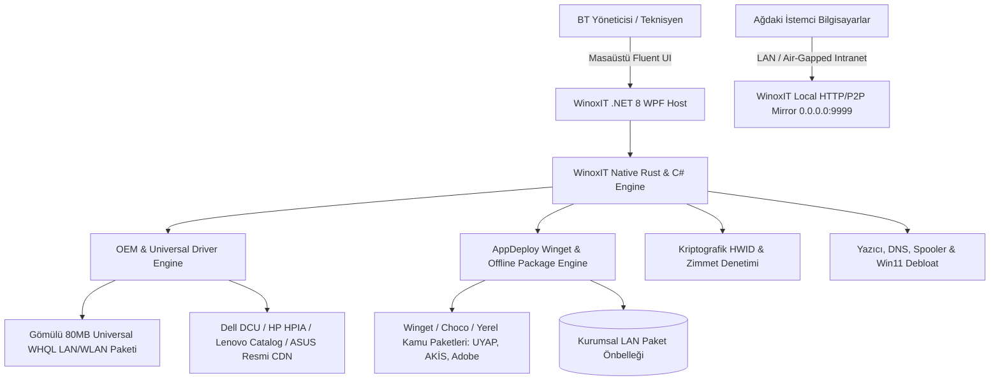
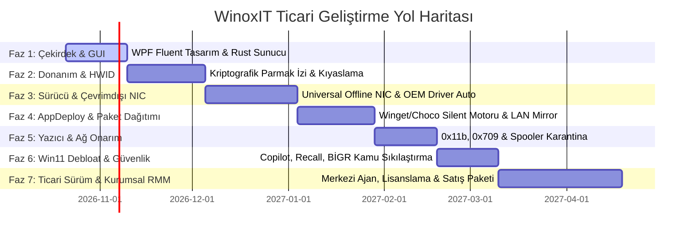

# ⚡ WinoxIT — Enterprise Windows IT, Hardware & Deployment Suite
## Kurumsal & Ticari Ürün Geliştirme Yol Haritası (Commercial Strategic Roadmap)

> **Proje Konumu:** `C:\Users\BT\Documents\Github\WinoxIT`  
> **Mimari:** .NET 8 WPF Fluent UI + Native Rust Çekirdek Motoru + 0.0.0.0:9999 Sanal Ağ & Önbellek Sunucusu  
> **Hedef Pazar:** BTK, Bakanlıklar, Kamu Bilgi İşlem Daireleri, Kurumsal Şirketler ve Profesyonel Teknik Servisler.  
> **Güvenlik Standardı:** Cumhurbaşkanlığı Dijital Dönüşüm Ofisi *Bilgi ve İletişim Güvenliği Rehberi (BİGR)*, KVKK ve Air-Gapped (Kapalı İntranet) uyumlu.

---

## 1. 🌐 Piyasa Analizi ve Ticari Konumlandırma (Market Gap & Competitive Edge)

Piyasadaki mevcut çözümler ya tekil teknisyen araçlarıdır (kurumsal güvenlik ve merkezi yönetimden yoksundur) ya da ağır, aşırı pahalı RMM sistemleridir:

| Kategori | Mevcut Pazar Çözümleri | Sektörel Açık & Zayıflık | **WinoxIT Ticari Avantajı** |
| :--- | :--- | :--- | :--- |
| **Toplu Program Kurulumu** | Ninite, Patch My PC | Ninite kapalı ağlarda (air-gap) çalışmaz; proxy desteği zayıftır. Lisanslama cihaz başı pahalıdır. | **WinoxIT AppDeploy:** Winget & Choco motoru + **Yerel LAN Önbellekleme (Offline Mirror)** ile internet kotasını tüketmeden 1 Gbps LAN hızında sessiz kurulum. Kamu e-İmza/UYAP hazır paketleri. |
| **Sürücü & Donanım Tespiti** | Snappy Driver (SDI), 3DP Net | SDI 50 GB güvensiz torrent sürücüleri çeker; 3DP Net eski ve reklamlıdır. Kurumlara sokulamaz. | **WinoxIT DriverEngine:** Yalnızca **resmi üretici (Dell, HP, Lenovo, Asus vb.) WHQL imzalı kataloglardan** çeker. Dahili **Evrensel Çevrimdışı LAN/WLAN Paketi** ile format sonrası anında internet. |
| **Kurumsal Dağıtım & RMM** | ManageEngine, PDQ Deploy, Intune | Ağır SQL veritabanı, domain controller yetkisi ve sunucu altyapısı ister; sahada USB'den anında çalışamaz. | **Hibrit Yapı:** Hem USB'den sıfır kurulumla çalışan "Saha Mühendisliği Konsolu" hem de `0.0.0.0:9999` üzerinden ajanlı/ajansız ağ dağıtım istasyonu. |
| **Donanım Ekspertizi** | AIDA64, HWiNFO | Değişen parçaları geçmişe dönük kriptografik olarak denetleyemez (Anti-tamper / zimmet takibi yoktur). | **Kriptografik HWID Drift:** SHA-256 ile RAM, SSD, CPU parça değişimini kırmızı alarmla tespit eden kurum onaylı zimmet/ekspertiz raporlama. |

---

## 2. 🏗️ Mimari Tasarım & Hibrit Ağ Mimarisi



---

## 3. 🎯 Katil Ticari Özellikler (Key Commercial Features)

### 🚀 A. Gömülü Evrensel Çevrimdışı Ağ Kartı Sürücü Paketi (Universal Offline NIC Engine)
* **Problem:** Format sonrası bilgisayarların %40'ında ağ kartı sürücüsü yüklenmez; internet olmadığı için hiçbir sürücü veya program indirilemez (teknisyenin en büyük kabusu).
* **WinoxIT Çözümü:**
  * En sık kullanılan Ethernet ve Wi-Fi üreticilerinin (Intel I219/I225/AX200/AX210, Realtek RTL8111/8125/8821/8822, Broadcom, MediaTek, Atheros) en güncel Microsoft WHQL onaylı `.inf` sürücülerini ZSTD/LZMA ile yüksek oranda sıkıştırılmış **~80-120 MB** ultra hafif bir arşivde gömülü tutar.
  * Windows PnP Device ID'yi anında tarar; eksik ağ kartını tespit edip `pnputil.exe /add-driver ... /install` ile **5 saniye içinde sıfır internet gereksinimiyle devreye sokar.**

### 🔍 B. Ağ Üzerinden Anakart/Cihaz Tespiti ve Orijinal OEM Sürücü İndirici
* **Otomatik SMBIOS/DMI Analizi:** Anakart üreticisi, model adı, BIOS sürümü, sistem SKU ve PCI donanım kimliklerini çıkarır.
* **Resmi Kurumsal Katalog API Entegrasyonu:**
  * **Dell:** Dell Business Client Update Catalog (`dcu-cli.exe` & Dell Service Tag API).
  * **HP:** HP Image Assistant (HPIA) & HP CMSL Softpaq katalogları.
  * **Lenovo:** Lenovo System Update / ThinInstaller XML API.
  * **Toplama / Tüketici Anakartları (ASUS, MSI, Gigabyte, ASRock):** Model bazlı resmi destek CDN ve Intel/Realtek chipset havuzu.
* **Ağ Üzerinden Sürücü Dağıtımı:** Ağdaki bir bilgisayarın donanım kimliğini uzaktan okuyup sürücü paketini ana istasyona indirme, yerel ağdan hedef istemciye sessizce aktarıp kurma.

### 📦 C. Kurumsal Ninite/Winget Uygulama Dağıtım Motoru (WinoxIT AppDeploy)
* **Görsel & Kategorize Edilmiş Yazılım Marketi:** Teknisyen veya BT yöneticisi tek ekrandan programları seçer (Chrome, 7-Zip, AnyDesk, LibreOffice, VLC, VS Code, Git vb.).
* **Tek Tıkla Sessiz (Silent / Unattended) Kurulum:** Kullanıcıya hiçbir "Next-Next" veya reklam/toolbar penceresi çıkarmadan arka planda tam kurulum.
* **Kamu & Kurum Özel Paketleri:** UYAP Editör, Kamu e-İmza sürücüleri (AKİS / TÜBİTAK UEKAE), E-Fatura araçları, DYS (Doküman Yönetim Sistemi) hazır konfigürasyonları.
* **Yerel LAN Önbellekleme (Offline Mirror):** Bir program bir kez indirildiğinde `C:\WinoxIT\Cache` klasörüne depolanır. Ağdaki diğer 50 bilgisayar internet kotası harcamadan yerel ağdan 1 saniyede kurulur (Dışa kapalı askeri/kamu intranetleri için mükemmel çözüm).

---

## 4. 🗺️ Genişletilmiş Geliştirme Yol Haritası (Phased Roadmap)



---

### 📍 FAZ 1: Çekirdek Mimari, WPF Fluent UI & LAN Web Kokpiti (Tamamlanma: %80)
- [x] Modern Koyu Tema .NET 8 WPF Fluent UI ve Responsive Menü Tasarımı.
- [x] `0.0.0.0:9999` üzerinden çalışan asenkron yerel web konsolu (`web/dashboard.html`).
- [x] Temel sistem işlemleri (DNS Flush, Temp temizleme, Spooler yeniden başlatıcı).
- [ ] *Sıradaki Adım:* Canlı sistem kaynakları (CPU, RAM, Disk, Ağ I/O) göstergelerinin UI'a bağlanması.

---

### 📍 FAZ 2: Kriptografik Donanım Ekspertizi & Parça Değişim Tespiti (HWID Engine)
- [x] WMI ve yerel API'ler ile temel donanım listeleme (`modules/hardware.rs`).
- [ ] RAM slotları (Seri no, frekans, üretici), NVMe/SSD disk seri no ve SMART sağlık verileri.
- [ ] **Deterministik SHA-256 HWID Üretimi:** Cihaz teslim alma referans (Baseline) kaydı.
- [ ] **Donanım Sapma (Drift) Raporu:** Değiştirilen, eksilen parçaları kırmızı alarm ile bildirme ve resmi imzalı PDF/HTML ekspertiz çıktısı.

---

### 📍 FAZ 3: Evrensel Ağ Kartı Paketi & OEM Sürücü Orkestratörü (YENİ KATİL MODÜL)
- [ ] **Gömülü Evrensel Ağ Kartı Paketi (Universal Offline NIC):**
  - Intel, Realtek, Broadcom, MediaTek, Atheros Ethernet/Wi-Fi WHQL INF sürücü arşivini hazırlama ve LZMA/ZSTD ile sıkıştırma.
  - Sürücüsüz ağ kartlarını `Win32_PnPEntity` ile tespit edip `PnPUtil` ile 5 saniyede internetsiz devreye alma.
- [ ] **Anakart ve Model Tespiti:**
  - BaseBoard Manufacturer/Product, System SKU ve BIOS UUID çıkarma.
- [ ] **Resmi OEM Sürücü İndirici Motoru:**
  - Dell (Service Tag & DCU CLI), HP (HPIA & CMSL), Lenovo (ThinInstaller) ve ASUS/MSI resmi katalog entegrasyonu.
  - Ağ üzerinden hedef makinenin sürücülerini uzaktan tarayıp sessiz kurulum orkestrasyonu.

---

### 📍 FAZ 4: Kurumsal AppDeploy & Paket Dağıtımı (Ninite/Winget Alternatifi) (YENİ KATİL MODÜL)
- [ ] **Görsel Uygulama Kataloğu:**
  - 100+ kurumsal ve popüler uygulama (Tarayıcılar, Ofis, Geliştirici Araçları, Medya, Sistem Araçları).
  - Kamu Özel Paketi: UYAP Editör, AKİS Akıllı Kart Sürücüsü, TÜBİTAK e-İmza yığınları.
- [ ] **Sessiz (Silent / Unattended) Kurulum Yürütücüsü:**
  - `winget install --silent --accept-package-agreements --accept-source-agreements` ve özel parametre yürütücüsü.
- [ ] **Kurumsal LAN Önbellekleme (Offline Mirror):**
  - İndirilen kurulum dosyalarını yerel ağdaki WinoxIT sunucusunda saklayarak diğer bilgisayarlara yerel ağdan anında dağıtma (Bandwidth & Kota Tasarrufu).

---

### 📍 FAZ 5: Kurumsal Yazıcı, Ağ & Spooler Onarım Paketi
- [x] 0x0000011b RPC yetkilendirme kayıt defteri onarımı (`RpcAuthnLevelExemption`).
- [x] 0x00000709 Point & Print kısıtlama onarımı.
- [ ] Kilitli `C:\Windows\System32\spool\PRINTERS` dosyalarını güvenli temizleme motoru.
- [ ] TCP/IP Stack, Winsock, NetBIOS ve yerel güvenlik duvarı kurallarını fabrika ayarlarına sıfırlama.

---

### 📍 FAZ 6: Windows 11 Debloat, Gizlilik & BİGR Kamu Sıkılaştırma Kalkanı
- [x] Windows 11 Copilot ve Windows Recall AI telemetrisini devre dışı bırakma.
- [x] Klasik Windows 10 Sağ Tık Menüsünü geri getirme / açıp kapatma.
- [ ] Kamu *Bilgi ve İletişim Güvenliği Rehberi (BİGR)* Sıkılaştırma Profili:
  - SMBv1, LLMNR, NBT-NS broadcast protokollerini kapatma.
  - USB depolama birimlerini tek tıkla kısıtlama (DLP / Salt Okunur veya Tam Engelleme).
  - BitLocker ve TPM 2.0 doğrulama ve kurtarma anahtarı yedekleme.

---

### 📍 FAZ 7: Ticari Paketleme, Lisanslama & Kurumsal Satış Hazırlığı
- [ ] **Bağımsız Taşınabilir Mod (Standalone Portable & WinPE):**
  - Kurulum gerektirmeyen tek bir `.exe` olarak USB bellekten doğrudan çalışabilme.
  - Windows çökmelerinde WinPE kurtarma medyasında çalışabilme yeteneği.
- [ ] **Lisanslama ve Aktivasyon Modülü:**
  - Donanıma bağlı makine lisanslama, kamu kurumları için kurumsal site lisansı (Dongle / Offline Aktivasyon).
- [ ] **Markalama & Raporlama (White-Label):**
  - Kurum logolu ve mühürlü teknik servis ekspertiz raporları (PDF).

---

## 5. 📂 Güncel Proje Dizin Yapısı

```text
C:\Users\BT\Documents\Github\WinoxIT\
├── WinoxIT_Roadmap.md               <-- Kurumsal ticari geliştirme yol haritası
├── README.md                        <-- Ürün tanıtımı ve kamu standartları dökümantasyonu
├── drivers/                         <-- Evrensel Çevrimdışı Sürücü Deposu
│   ├── universal_nic/               <-- Intel, Realtek, Broadcom sıkıştırılmış INF arşivi
│   └── oem_scripts/                 <-- Dell, HP, Lenovo katalog orkestrasyon araçları
├── packages/                        <-- Yerel LAN Yazılım Önbelleği (Offline Mirror)
│   ├── kamu/                        <-- UYAP, AKİS, TÜBİTAK e-İmza paketleri
│   └── common/                      <-- Chrome, 7-Zip, AnyDesk vb. MSI/EXE paketleri
├── gui/                             <-- .NET 8 WPF Fluent UI masaüstü uygulaması
│   ├── WinoxIT.csproj
│   ├── MainWindow.xaml / cs         <-- Ana kontrol ve vitrin arayüzü
│   ├── Views/                       <-- AppDeploy, Drivers, Hardware, Repair sekmeleri
│   ├── Styles/FluentStyles.xaml     <-- Kurumsal Fluent Koyu Tema
│   └── Services/                    <-- NativeSystemEngine & OEM Client yöneticileri
├── core/                            <-- Native Rust çekirdek motoru ve CLI
│   ├── Cargo.toml
│   └── src/
│       ├── main.rs
│       └── modules/
│           ├── hardware.rs          <-- SMBIOS & Kriptografik HWID
│           ├── drivers.rs           <-- PnPUtil & Universal NIC enjeksiyonu
│           ├── appdeploy.rs         <-- Winget & Silent Installer yürütücüsü
│           └── network.rs           <-- LAN Cache Web Sunucusu (0.0.0.0:9999)
└── web/                             <-- Mobil & Uzak Cihazlar için Cyber HUD Kokpiti
    └── dashboard.html
```

---
*WinoxIT, kamu kurumları ve kurumsal BT filoları için yerli, bağımsız ve tam yetkili bir ekosistem olarak ticarileşmeye hazırdır.*

